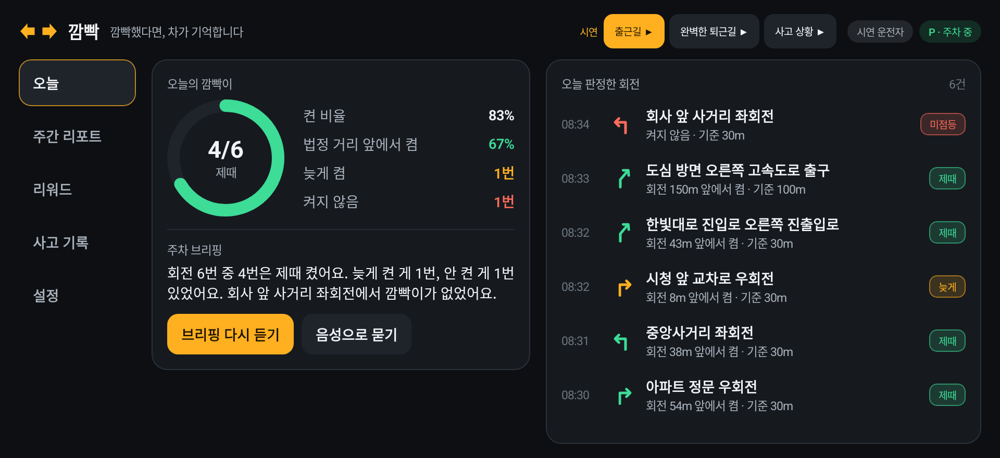
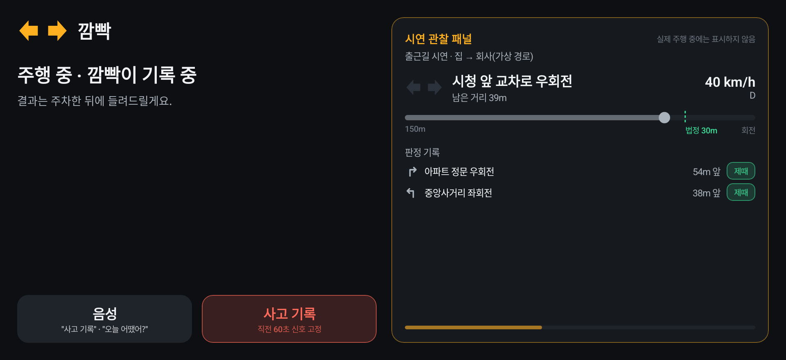
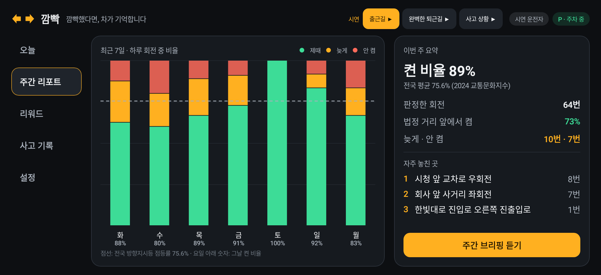
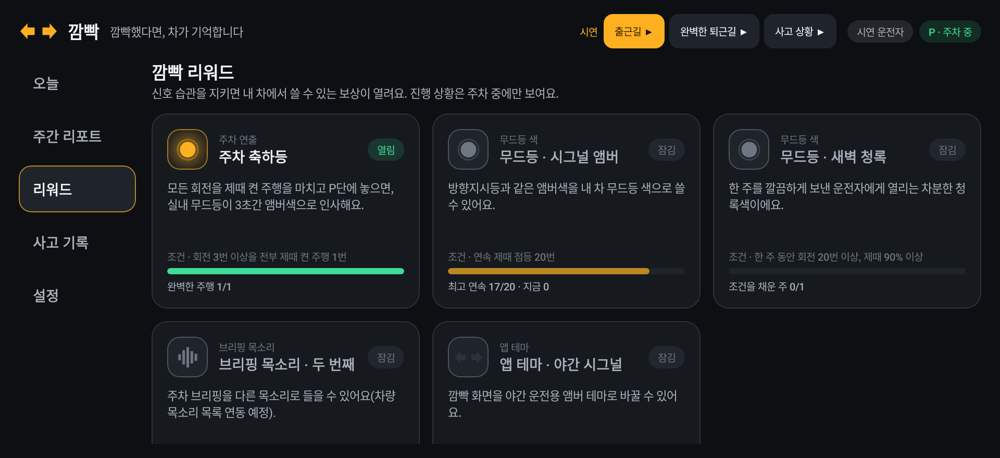
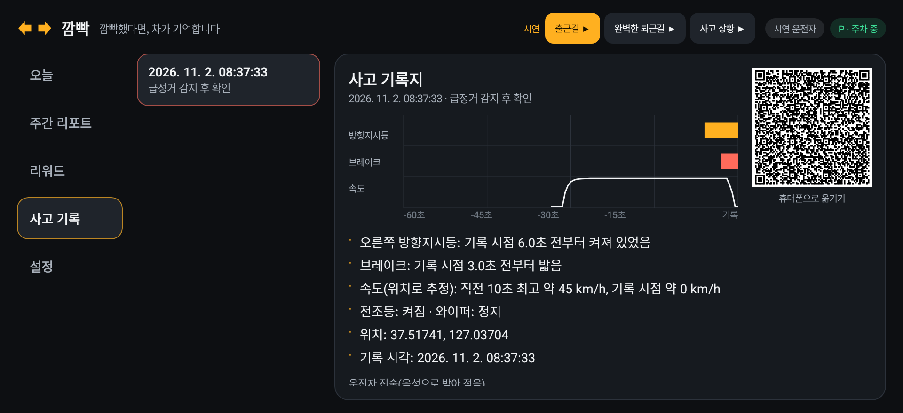

# 깜빡 — 깜빡했다면, 차가 기억합니다

**한 줄 소개** 회전·진로변경 때 방향지시등을 켰는지, 법정 거리 앞에서 켰는지를 차가 기록하고 주차 후 10초 음성 브리핑으로 습관을 바꿔 주는 Pleos Connect 앱. 사고가 나면 직전 60초의 차량 신호를 사고 기록지로 남깁니다.



| 주행 중(시연 관찰 패널 포함) | 주간 리포트 |
| --- | --- |
|  |  |
| **깜빡 리워드** | **사고 기록지** |
|  |  |

## APK

- 위치: [`apk/kkambbak_kkambbak_release.apk`](apk/kkambbak_kkambbak_release.apk) (release 서명, minSdk 28 · targetSdk 34)

## 실행 방법

1. Android Studio에서 Pleos Connect Emulator(Android API 34 시스템 이미지)를 설치하고 AVD를 만듭니다.
   설치 안내: Pleos Playground 문서 「Installing and Running Pleos Connect Emulator」
2. 에뮬레이터를 켠 뒤 APK를 설치합니다.
   ```bash
   adb install -d -r apk/kkambbak_kkambbak_release.apk
   adb shell monkey -p app.kkambbak -c android.intent.category.LAUNCHER 1
   ```
3. 첫 실행 때 위치(`pleos.car.permission.FUSED_LOCATION`)와 마이크 권한을 허용합니다.
4. **시연 모드로 보기(권장)**: 오늘 화면의 「시연 모드로 둘러보기」 또는 설정 → 운전자 → 「시연 운전자」를 고릅니다.
   상단의 「출근길 ▶」「완벽한 퇴근길 ▶」「사고 상황 ▶」을 누르면 가상 주행이 실제 판정 엔진을 거쳐 재생됩니다.
   - 출근길: 회전 6번(제때 4 · 늦게 1 · 미점등 1) → 주행 화면 → 주차 후 음성 브리핑
   - 완벽한 퇴근길: 회전 3번 모두 제때 → 주차 축하등(리워드)
   - 사고 상황: 합류 중 급정거 → 기록 제안 → 2차 사고 예방 안내 → 진술 → 사고 기록지(QR·해시)
5. **실차 신호로 보기**: Pleos Connect Virtual Console(`adb forward tcp:8088 tcp:8088`)에서 기어·방향지시등·브레이크를 바꾸고,
   내장 내비로 경로 안내를 시작하면 회전 안내(TBT)마다 판정이 쌓입니다. 주행 제한 상태 전환은
   `adb shell cmd hmg_car_service --service drivingstate driving_regulation on|off` 로 확인할 수 있습니다.

## 테스트 환경 및 필요한 설정

| 항목 | 내용 |
| --- | --- |
| 빌드 | JDK 17+, Gradle 8.14.3(wrapper 포함), AGP 8.7.3, Kotlin 2.0.21, compileSdk 35 |
| 런타임 | Pleos Connect Emulator 2.1.0 이상(Android API 34). 일반 안드로이드 기기에서도 시연 모드는 동작(SDK 연결 실패 시 안전하게 대체) |
| 권한 | `pleos.car.permission.CAR_LIGHTS`, `CAR_DRIVE`, `CAR_WINDOWS`, `CONTROL_CAR_LIGHTS`, `NAVI_ROUTE`, `FUSED_LOCATION`, `TTS_SERVICE`, `STT_SERVICE`, `RECORD_AUDIO` |
| 앱 카테고리 | Mobility Services(주행과 밀접한 차량 관리) |
| 서버 | 없음. 모든 판정은 차 안(온디바이스)에서 끝남 |

```bash
./gradlew :core:test                 # 판정 엔진 단위 테스트 14개
./gradlew :app:testReleaseUnitTest   # 앱 전체 흐름 스모크 테스트(Robolectric, Pleos 서비스 없는 환경)
./gradlew :app:assembleRelease       # keystore.properties가 있으면 release 서명
./gradlew :ui:testDebugUnitTest      # 실제 Compose 화면을 JVM에서 렌더링(ui/build/screens)
```

## Pleos Connect SDK 사용

| SDK | 쓰는 곳 |
| --- | --- |
| Vehicle 2.3.2 | `TurnSignal`(판정의 핵심), `Gear`(주행 시작·종료, 주차 판단), `Brake`·`Light`(하향등)·`Wiper`(사고 기록), `Light` 앰비언트 색(리워드) |
| NaviHelper 3.0.5 | `onTBTInfo` / `getTBTInfo`: 다음 회전·분기 종류와 남은 거리, `onNavigationStatus` |
| FusedLocation 1.1.3 | 위치·진행방향 → 이동 거리 추정, 실제 회전 확인, 내비 없는 회전 감지, 급정거 감지 |
| TextToSpeech 3.3.1 | 주차 후 10초 브리핑, 주간 브리핑, 사고 직후 안내(한국어 · 온디바이스) |
| SpeechToText 3.3.1 | "사고 기록" · "오늘 어땠어" 음성 명령, 사고 경위 진술 받아쓰기(한국어 · 온디바이스) |
| AAOS CarUxRestrictions | 주행 제한 상태면 큰 버튼 두 개만 있는 주행 화면, 결과·목록은 주차 시에만 |

## 판정 로직(요약)

1. 내비 안내 다음 지점이 회전·분기이고 남은 거리가 150m(고속도로 300m) 안이면 관찰을 시작합니다.
2. 같은 쪽 지시등이 켜지면 그 순간의 남은 거리를 적고, 지점 전에 끄면 지웁니다. 반대쪽이면 '반대쪽'으로 남깁니다.
3. 좌·우회전·유턴은 지점을 지난 뒤 진행방향이 같은 쪽으로 45° 이상 바뀌어야 판정합니다(안내와 달리 직진했으면 판정하지 않음). 분기·진출입로는 지점을 30m 지나면 판정합니다.
4. 도로교통법 시행령 별표 2의 기준(일반도로 30m, 고속도로 100m) 이상 앞에서 켜 유지했으면 **제때**, 그 안이면 **늦게**, 없으면 **미점등**. 고속도로 여부는 고속도로 출구 안내이거나 시속 80km 이상이면 고속도로로 봅니다.
5. 내비 안내가 없을 때는 저속에서 진행방향이 60° 이상 바뀐 구간을 회전으로 보고, 켰는지만 판정합니다.

한계: 차로 변경은 차선 데이터(ADAS SDK)가 필요해 이번 버전 판정 대상이 아닙니다.

## 구조

```
core/   판정 엔진(순수 Kotlin) — SignalJudge, DriveSession, CrashRecorder, Reports, Rewards, DemoScript + 테스트
ui/     Jetpack Compose 화면 — UiState만 받아 그리는 상태 없는 화면 + Paparazzi 렌더링
app/    Pleos SDK 어댑터(car/), 음성(voice/), 저장(data/), Controller, MainActivity
tools/  화면 렌더링·시연 영상 제작 스크립트
```

## 데이터 원칙

- 서버 전송 없음. 주행 궤적은 저장하지 않고, 평소에는 회전별 판정 결과(회전 종류·판정·켠 거리)만 운전자별로 앱 내부 저장소에 남습니다.
- 회전 지점 이름(내비 안내)과 대략적 위치는 '자주 놓치는 곳 기억하기'를 켤 때만 저장합니다(기본 꺼짐, 시연 운전자는 켜짐).
- 사고 기록용 60초 버퍼(신호·위치 기반 추정 속도·위치)는 메모리에서 덮어쓰고, 운전자가 사고 기록을 남길 때만 저장합니다. 기록지는 사실 기록이며 과실 비율을 판단하지 않습니다.
- 운전자 프로필은 전환식이며 잠금은 없습니다. 외부(보험사 등) 제공 기능은 없습니다.
